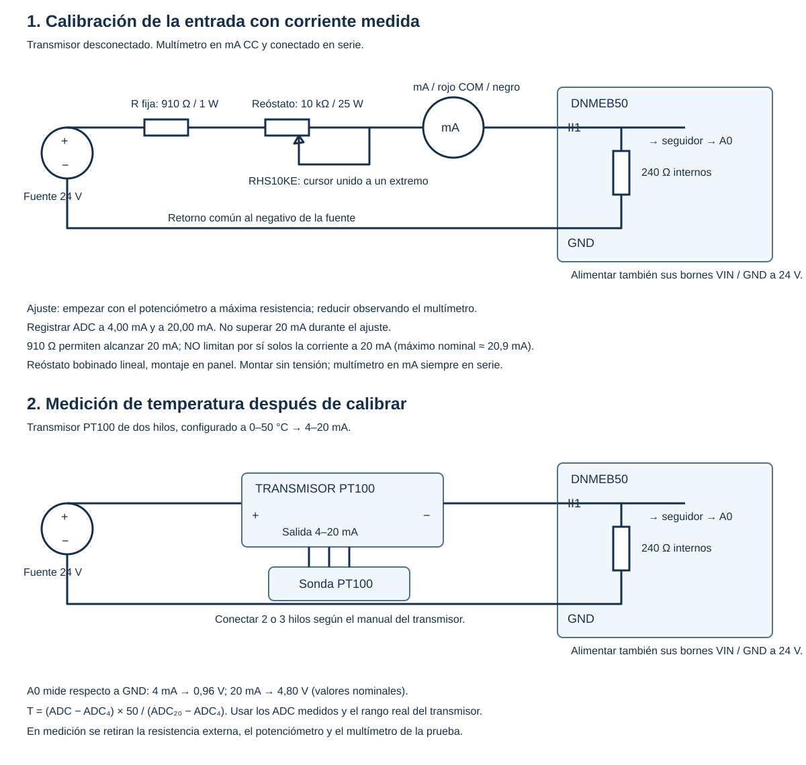
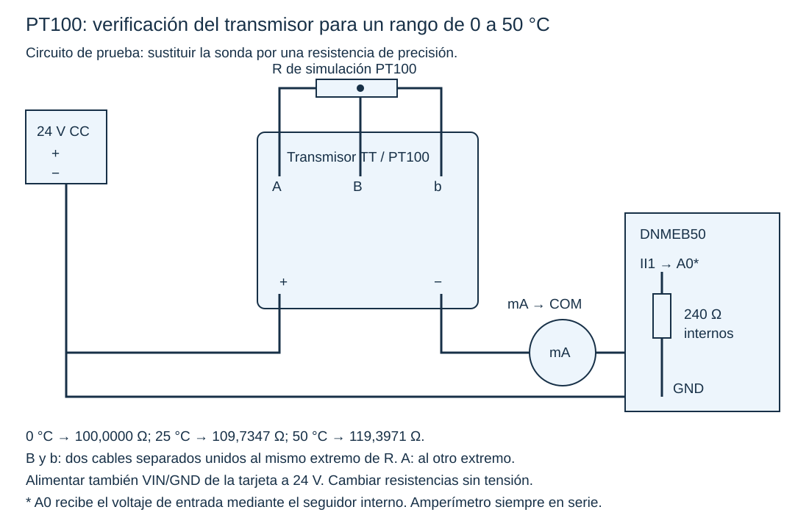

# Práctica de instrumentación industrial: PT100, transmisor TT y tarjeta DNMEB50

**Rango elegido:** 0–50 °C, equivalente a 4–20 mA.  
**Plataforma:** DNMEB50 con Arduino Mega 2560; entrada II1 → A0.  
**Alimentación nominal:** 24 V CC.  
**Alcance:** caracterización de la entrada de corriente, verificación y ajuste del transmisor, y medición de la cadena completa.

## 1. Objetivos y resultados esperados

Al finalizar, el estudiante podrá:

- Explicar cómo una alimentación de 24 V permite medir una señal inferior a 5 V en el ADC.
- Obtener experimentalmente la relación entre corriente y cuentas ADC.
- Configurar el transmisor PT100 para 0–50 °C.
- Simular la PT100 de tres hilos con resistencias conocidas.
- Registrar errores antes y después de ajustar ZERO y SPAN.
- Medir temperatura con la cadena completa y compararla con una referencia.
- Distinguir configuración de rango, verificación, ajuste y calibración.

**Configuración:** elegir los límites de entrada y salida. **Verificación:** comparar contra una referencia y evaluar el error. **Ajuste:** modificar la respuesta para reducir ese error. **Calibración:** establecer la relación entre indicaciones y referencias, con sus incertidumbres; no implica necesariamente ajustar. En esta guía se realiza una caracterización y ajuste didáctico. Una calibración con trazabilidad requiere referencias calibradas, incertidumbres y procedimiento documentado.

## 2. Información comprobada y límites

El esquema DNMEB50 del repositorio muestra resistencias de **240 Ω** en II1–II4 y seguidores de voltaje con LM324. El manual asigna II1–II4 a A0–A3, para entradas de 0–20 mA. II5–II8 son de 0–100 mA: no intercambiar estos grupos.

El código original utiliza `analogReference(DEFAULT)`: la referencia del Mega es su alimentación analógica, nominalmente 5 V, cuyo valor real puede diferir. El esquema es la base documental; comprobar que la revisión física de la tarjeta coincida.

El manual TT distingue transmisores para termocupla y para PT100. Esta práctica corresponde únicamente a **PT100**, salida de dos hilos 4–20 mA, alimentación especificada de 20–36 V CC. Los tres hilos de la PT100 son una conexión distinta del lazo de salida de dos hilos.

El menor span tabulado es 50 °C. Elegimos inicio 0 °C y fin 50 °C. Esta configuración no cubre un proceso que llegue a 60 °C; para ese proceso puede elegirse 0–100 °C.

Las constantes originales `adc_4mA = 205` y `adc_20mA = 820` no tienen un origen de calibración documentado en los archivos revisados. No utilizarlas como resultados experimentales. Además, el segundo canal del código original tiene un máximo de 150 °C aunque su comentario y etiqueta dicen 400 °C. La guía utiliza un solo canal con rango explícito 0–50 °C.

## 3. Materiales

| Elemento | Requisito / uso |
|---|---|
| Tarjeta y controlador | DNMEB50 con Mega 2560 |
| Fuente | 24 V CC regulada, preferiblemente con limitación de corriente |
| Multímetro | Medida de mA CC con entrada protegida y fusible correcto; registrar resolución y exactitud |
| Resistencia fija externa | 910 Ω, 1 W, preferiblemente 1 % o mejor |
| Reóstato | Bobinado lineal de 10 kΩ / 25 W, Ohmite RHS10KE o equivalente con corriente admisible de pista y cursor ≥25 mA |
| Transmisor | TT para PT100 de tres hilos, con SW101, SW102, ZERO ADJ y SPAN ADJ |
| Sonda | PT100 de tres hilos, apta para las temperaturas de trabajo |
| Simulación RTD | Simulador PT100 de tres hilos o caja de resistencias de precisión; alternativamente, resistencias fijas de precisión |
| Referencia térmica | Termómetro de referencia, idealmente calibrado |
| Baño | Recipiente con agua agitada y calentamiento controlado; conexiones eléctricas fuera del agua |
| Otros | Cables cortos, bornes, destornillador apropiado, computador y Arduino IDE o PlatformIO |

Para comprar: «Reóstato bobinado lineal de diez kiloohmios, veinticinco vatios, montaje en panel, referencia Ohmite RHS10KE o equivalente». No sustituirlo automáticamente por un potenciómetro de señal de 10 kΩ / 1 W.

### Por qué importa la potencia del reóstato

La potencia nominal corresponde a toda la pista. Como reóstato, solo parte de la pista disipa energía. La estimación `I_admisible ≈ sqrt(P_nominal/R_total)` da 10 mA para 10 kΩ / 1 W y 50 mA para 10 kΩ / 25 W. Revisar también límites del cursor, temperatura y montaje de la ficha. No se consumirán 25 W en este circuito: es la capacidad del componente elegido.

Para resistencias de simulación, preferir 0,01 % y bajo coeficiente térmico. Más decimales en una tabla no implican que el material disponible permita reproducirlos. Registrar el valor aplicado y su incertidumbre; medir con un multímetro corriente no necesariamente mejora el valor certificado de una resistencia de precisión.

## 4. Fundamento de la cadena

```text
Temperatura → resistencia PT100 → transmisor → corriente 4–20 mA
            → resistencia interna de 240 Ω → seguidor → ADC → temperatura indicada
```

En la entrada pasiva:

`V_II1 = I × 240 Ω`

`ADC ≈ (V_II1 / Vref) × 1023`

Con Vref nominal de 5 V:

| Corriente | Voltaje II1–GND | ADC nominal aproximado |
|---:|---:|---:|
| 4 mA | 0,96 V | 196 |
| 8 mA | 1,92 V | 393 |
| 12 mA | 2,88 V | 589 |
| 16 mA | 3,84 V | 786 |
| 20 mA | 4,80 V | 982 |

Son valores orientativos, no constantes obligatorias. La referencia, resistencias, seguidor, ruido y conversor afectan las lecturas.

Los 24 V se reparten entre el transmisor y la carga: con 20 mA hay 4,8 V sobre 240 Ω y aproximadamente 19,2 V sobre el transmisor, despreciando cables y amperímetro. El regulador de alimentación de la tarjeta cumple una función distinta de la conversión corriente–voltaje. El negativo del transmisor conectado a II1 no está a 0 V; su potencial respecto a GND es la tensión de entrada.

El manual indica carga máxima `(Vs − 16 V)/0,020 A`: a 24 V son 400 Ω. La tarjeta aporta 240 Ω; cables y carga interna del amperímetro deben caber en el margen restante. Si no se alcanzan 20 mA, comprobar tensión real y caída del amperímetro antes de ajustar SPAN.

## 5. Preparación común

1. Registrar fabricante, modelo, revisión y estado de cada equipo; fotografiar bornes, interruptores y posición inicial de ajustes.
2. Confirmar que el módulo físico coincida con el esquema y que la entrada usada sea II1.
3. Desenergizar antes de montar, cambiar resistencias o mover selectores.
4. Alimentar la tarjeta por sus bornes previstos, no aplicar 24 V directamente a A0 ni al pin de 5 V.
5. Conectar GND de la tarjeta al negativo de la fuente. GND es el retorno del circuito; no confundirlo con tierra de protección.
6. Configurar el multímetro en corriente continua y en una escala que admita al menos 20 mA. Conectar rojo al borne mA apropiado y negro a COM.
7. El amperímetro va en serie. Nunca conectarlo en modo corriente directamente entre los bornes de la fuente.
8. En las pruebas de corriente no sobrepasar 20 mA. El manual del transmisor indica salida por circuito abierto >22 mA; no provocar esa condición conectado a la tarjeta, cuyo rango documentado es 0–20 mA.

## 6. Práctica A: corriente frente a ADC

### 6.1 Montaje

Desconectar el transmisor del lazo de prueba. La resistencia interna de 240 Ω ya existe: no añadir otra en paralelo.

```text
+24 V → R fija 910 Ω / 1 W → reóstato 10 kΩ / 25 W
      → multímetro [mA → COM] → II1
                                  │
                              240 Ω internos
                                  │
− fuente ←────────────────────── GND
```

Alimentar también VIN y GND de la tarjeta por sus conexiones habituales.

El potenciómetro no tiene polaridad fija «más, menos y señal»: tiene extremos A/B y cursor W. Identificar sus terminales con ficha o multímetro sin tensión. Entre extremos la resistencia no cambia al girar; entre cursor y extremo sí.

```text
Desde R fija → A ───── pista resistiva ───── B → hacia multímetro
                         ↑                 │
                         W ────────────────┘
```

Unir W y B. Empezar con la máxima resistencia entre A y el conjunto B–W. La unión mantiene un camino por toda la pista si el cursor pierde contacto; no constituye una limitación precisa a 20 mA.



### 6.2 Límites del montaje

`I ≈ 24 V / (910 Ω + R_reóstato + 240 Ω + R_amperímetro + R_cables)`

Con 24 V nominales y despreciando amperímetro/cables:

- Para 4 mA: resistencia total 6000 Ω; reóstato alrededor de 4850 Ω.
- Para 20 mA: resistencia total 1200 Ω; reóstato alrededor de 50 Ω.
- Con el reóstato en cero: aproximadamente 20,87 mA. **La resistencia de 910 Ω no garantiza un límite de 20 mA.** Vigilar el multímetro, especialmente cerca del extremo de baja resistencia.
- Si la carga del multímetro o la tensión de fuente impiden llegar exactamente a 20 mA, no forzar ni retirar la resistencia fija. Registrar un punto superior real y utilizar su corriente en el cálculo, o utilizar un calibrador de lazo.

La propuesta previa de 1 kΩ limita el máximo nominal a 19,35 mA; la de 1,2 kΩ, a 16,67 mA. Ninguna permite asegurar 20 mA con esta carga y 24 V.

### 6.3 Lectura del ADC

Cargar este programa, disponible también en `Lectura_PT100.ino`:

```cpp
const int PIN_ENTRADA = A0;
const bool CALIBRACION_CARGADA = false;
// Sustituir por resultados propios ANTES de habilitar la conversión.
const float I_BAJA = 4.0f;    // Corriente real medida, mA
const float I_ALTA = 20.0f;   // Corriente real medida, mA
const float ADC_BAJO = 0.0f;  // Promedio experimental inferior
const float ADC_ALTO = 0.0f;  // Promedio experimental superior
const float T_MIN = 0.0f;
const float T_MAX = 50.0f;

float leerPromedio() {
  long suma = 0;
  for (int k = 0; k < 50; ++k) {
    suma += analogRead(PIN_ENTRADA);
    delay(2);
  }
  return suma / 50.0f;
}

void setup() {
  Serial.begin(9600);
  analogReference(DEFAULT);
}

void loop() {
  const float adc = leerPromedio();
  Serial.print("ADC=");
  Serial.print(adc, 2);
  if (CALIBRACION_CARGADA && ADC_ALTO > ADC_BAJO && I_ALTA > I_BAJA) {
    const float corriente = I_BAJA + (adc - ADC_BAJO)
      * (I_ALTA - I_BAJA) / (ADC_ALTO - ADC_BAJO);
    Serial.print("; mA=");
    Serial.print(corriente, 3);
    if (corriente >= 4.0f && corriente <= 20.0f) {
      const float temperatura = T_MIN + (corriente - 4.0f)
        * (T_MAX - T_MIN) / 16.0f;
      Serial.print("; T_C=");
      Serial.print(temperatura, 2);
    } else {
      Serial.print("; FUERA_DEL_INTERVALO_NOMINAL_4_20_mA");
    }
  } else {
    Serial.print("; registrar ADC y corriente del multimetro");
  }
  Serial.println();
  delay(500);
}
```

Durante esta etapa dejar `CALIBRACION_CARGADA = false`. El programa informa ADC sin inventar una conversión. El promedio reduce ruido; los decimales no aumentan por sí solos la exactitud ni la resolución física del ADC.

### 6.4 Procedimiento y tabla

1. Con el reóstato al máximo, energizar y comprobar que la corriente sea baja.
2. Reducir lentamente su resistencia hasta aproximadamente 4 mA.
3. Esperar estabilidad. Registrar simultáneamente corriente real y al menos diez promedios ADC. Calcular media y dispersión.
4. Repetir a aproximadamente 8, 12, 16 y 20 mA sin superar 20 mA.
5. Repetir en sentido descendente para evaluar repetibilidad y posible deriva.
6. Si se mide voltaje II1–GND con el mismo multímetro, desenergizar y reconfigurar puntas/función; esa medida no es simultánea con la de corriente. Usar un segundo multímetro si se requiere simultaneidad.

| Punto | I real (mA) | ADC medio ascendente | ADC medio descendente | Dispersión ADC | V II1–GND, opcional |
|---|---:|---:|---:|---:|---:|
| Inferior ≈4 mA | | | | | |
| ≈8 mA | | | | | |
| ≈12 mA | | | | | |
| ≈16 mA | | | | | |
| Superior ≈20 mA | | | | | |

### 6.5 Conversión experimental

Con los pares medidos `(ADC_bajo, I_baja)` y `(ADC_alto, I_alta)`:

`I_estim = I_baja + (ADC − ADC_bajo) × (I_alta − I_baja)/(ADC_alto − ADC_bajo)`

Usar las corrientes reales, aunque sean, por ejemplo, 4,03 y 19,70 mA. No llamar 20 mA a una corriente distinta. Si se desea estimar las cuentas correspondientes exactamente a 4 y 20 mA:

`ADC_4 = ADC_bajo + (4 − I_baja) × (ADC_alto − ADC_bajo)/(I_alta − I_baja)`

`ADC_20 = ADC_bajo + (20 − I_baja) × (ADC_alto − ADC_bajo)/(I_alta − I_baja)`

Si 20 mA queda fuera del intervalo realmente probado, esa cuenta es una extrapolación, no una verificación experimental a 20 mA.

Para los puntos intermedios calcular `error_I = I_estim − I_multímetro`. Graficar ADC frente a corriente y los residuos frente a corriente. Opcionalmente ajustar una recta por mínimos cuadrados usando todos los puntos; documentar qué método se elige.

Cargar los cuatro valores experimentales en el programa y habilitar `CALIBRACION_CARGADA`. No modificar esta calibración para ocultar errores del transmisor.

## 7. Práctica B: transmisor PT100 configurado para 0–50 °C

### 7.1 Selectores y ajustes

Según la tabla PT100 del manual:

| Bloque | Función | Interruptor 1 | 2 | 3 | 4 |
|---|---|---|---|---|---|
| SW101 | Inicio 0 °C | OFF | OFF | ON | OFF |
| SW102 | Amplitud 50 °C | OFF | OFF | OFF | OFF |

Usar la numeración y la marca ON del propio bloque; no deducir posiciones por izquierda/derecha de una fotografía. Configurar sin tensión.

- **ZERO ADJ:** corrección fina del extremo inferior; con entrada equivalente a 0 °C, buscar 4 mA.
- **SPAN ADJ:** corrección fina de la amplitud; con entrada equivalente a 50 °C, buscar 20 mA.
- El manual indica que el giro horario aumenta la salida. Hacer cambios pequeños sin forzar topes.
- El manual declara ajustes de cero ≤10 % y span ≤20 % del fondo de escala; no garantiza cualquier rango arbitrario. Los selectores establecen el rango nominal.
- Estos ajustes no sustituyen un simulador ni permiten imponer 4/20 mA con una entrada cualquiera.

### 7.2 Valores de simulación

Para una PT100 IEC de coeficiente nominal 0,00385, en el intervalo positivo:

`R(T) = 100 × [1 + 0,0039083 × T − 0,0000005775 × T²] Ω`

| T simulada (°C) | R nominal (Ω) | I ideal para 0–50 °C (mA) |
|---:|---:|---:|
| 0 | 100,0000 | 4 |
| 12,5 | 104,8764 | 8 |
| 25 | 109,7347 | 12 |
| 37,5 | 114,5749 | 16 |
| 50 | 119,3971 | 20 |

No promediar simplemente las resistencias de los extremos para obtener la temperatura media: la curva PT100 no es exactamente lineal.

La tabla define los valores objetivo, no la exactitud disponible. Con resistencias fijas pueden realizarse combinaciones en serie y registrar el valor efectivo; para ajustar puntos exactos es preferible un simulador RTD o caja de resistencia adecuada. El reóstato de potencia de la práctica A no es la referencia para simular la PT100.

### 7.3 Sustitución de la PT100 de tres hilos

1. Apagar y fotografiar los tres hilos originales.
2. Desconectarlos de los bornes de sensor **b, B y A**. No confundirlos con los bornes +/− del lazo.
3. Conectar el valor R elegido entre A y un punto común de dos cables dirigidos a B y b:

```text
A del transmisor ─────────[ R de precisión ]────●
                                               ├──── cable independiente → B
                                               └──── cable independiente → b
```

Usar tres cables cortos, de igual material/sección y longitudes similares. Las resistencias de contacto y diferencias de cables introducen error; registrar la conexión. Un simulador RTD debe conectarse según su manual, en modo PT100 de tres hilos compatible con el transmisor.



### 7.4 Lazo de medida

Retirar resistencia fija y reóstato de la práctica A. Conectar:

```text
Fuente +24 V → transmisor (+)
Transmisor (−) → multímetro, entrada mA
Multímetro COM → II1 de DNMEB50
GND de DNMEB50 → negativo de fuente
```

La tarjeta sigue alimentada por VIN/GND. La resistencia interna es la carga del lazo; el Arduino puede registrar corriente usando la calibración A. El multímetro es la referencia independiente de corriente. Comprobar el presupuesto de carga del apartado 4.

### 7.5 Verificación inicial, sin ajustar

1. Confirmar los selectores 0–50 °C.
2. Aplicar 100 Ω, energizar y esperar estabilidad. Anotar corriente y ADC.
3. Apagar para cambiar el valor. Repetir con cada resistencia de la tabla.
4. Completar la columna «antes de ajustar». No borrar esos datos.
5. Calcular `error_I = I_medida − I_ideal` y `error_T_equiv = error_I × 50/16`.
6. Si cumple el criterio docente y las necesidades del proceso, no es necesario mover los potenciómetros.

### 7.6 Ajuste, si es necesario

1. Aplicar 100 Ω, energizar y ajustar ZERO para 4,000 mA, hasta donde permita la resolución del multímetro.
2. Apagar, aplicar 119,3971 Ω y energizar. Ajustar SPAN para 20,000 mA sin sobrepasar la entrada de la tarjeta.
3. Repetir ambos extremos hasta obtener estabilidad dentro del criterio fijado. Los ajustes pueden interactuar.
4. Si no se alcanzan, revisar selectores, bornes, valor real de R, alimentación, carga de amperímetro y modelo del transmisor. No forzar los potenciómetros.
5. Volver a comprobar los cinco puntos, preferiblemente en subida y bajada. Registrar datos posteriores al ajuste.

| T simulada | R aplicada real | I ideal | I antes | Error antes | I después | Error después | ADC |
|---:|---:|---:|---:|---:|---:|---:|---:|
| 0 | | 4 | | | | | |
| 12,5 | | 8 | | | | | |
| 25 | | 12 | | | | | |
| 37,5 | | 16 | | | | | |
| 50 | | 20 | | | | | |

Si R aplicada difiere significativamente del objetivo, calcular su temperatura equivalente con la relación PT100 y la corriente ideal correspondiente, en vez de atribuirle exactamente la temperatura de la primera columna.

**Resultado:** queda verificada la conversión resistencia PT100 → corriente. La sonda real todavía no ha sido verificada.

## 8. Práctica C: medición con PT100, transmisor y tarjeta

### 8.1 Montaje final

1. Apagar. Retirar la resistencia de simulación.
2. Reconectar los tres hilos de la sonda a sus bornes originales. No asumir por color: dos hilos pertenecen al mismo extremo del elemento y van a B/b; el restante va a A. Con la sonda desconectada, entre los dos del mismo extremo se mide una resistencia pequeña y entre estos y el tercero aproximadamente la resistencia PT100 más los cables.
3. Retirar el multímetro del lazo para el montaje definitivo y unir transmisor (−) directamente con II1.
4. Mantener SW101/SW102 en 0–50 °C y los ajustes verificados.

```text
PT100, extremo 1 ───────────────────────── A
PT100, extremo 2 ── hilo independiente ─── B
                  └ hilo independiente ── b

+24 V ── transmisor (+)
         transmisor (−) ──────────────── II1
                                         │
                                     240 Ω internos
                                         │
Negativo fuente / 0 V ──────────────────── GND

Fuente +24 V y retorno → bornes habituales de alimentación de tarjeta.
```

El negativo de la fuente se toma como referencia de 0 V para todo el lazo.

### 8.2 Programa y conversiones

Usar el programa del apartado 6 con los valores propios de la práctica A, conversión habilitada y `T_MIN = 0`, `T_MAX = 50`.

`I = 4 + 16 × T/50` y `T = (I − 4) × 50/16`.

Si los puntos de corriente son exactamente 4 y 20 mA:

`T = (ADC − ADC_4) × 50/(ADC_20 − ADC_4)`.

El programa convierte resistencia mediante el transmisor; no necesita volver a calcular la curva PT100 en Arduino. Evitar recortar silenciosamente lecturas a 0/50 °C: una lectura fuera del intervalo debe registrarse y estudiarse. La etiqueta de rango no diagnostica por sí sola una avería. No inducir fallos de circuito abierto con esta tarjeta conectada.

### 8.3 Comparación térmica

1. Colocar PT100 y termómetro de referencia próximos, a similar profundidad y con la inmersión recomendada por cada fabricante. No sumergir conexiones no estancas.
2. Usar agua agitada para reducir gradientes. Evitar contacto con pared, fondo o calentador.
3. Comenzar cerca de temperatura ambiente y obtener varios puntos dentro de 0–50 °C, por ejemplo 10, 20, 30, 40 y 45 °C. No es necesario alcanzar exactamente cada consigna: registrar la temperatura real de referencia.
4. Esperar equilibrio térmico. Como criterio didáctico inicial, registrar cuando la referencia cambie menos de 0,1 °C durante un minuto, si la resolución lo permite; documentar el criterio utilizado.
5. Registrar al menos diez lecturas por punto y sus tiempos. Promediar solo cuando el sistema esté estable.
6. Repetir algunos puntos en enfriamiento. Considerar el retardo térmico antes de interpretar diferencias como histéresis.
7. Si se desea incluir 0 °C, preparar correctamente un baño de hielo triturado y agua con hielo remanente; no atribuir 0 °C a cualquier vaso con agua fría.
8. Si se conserva temporalmente el amperímetro para comparar, verificar su carga. Después retirarlo sin tensión.

| Punto | T referencia (°C) | ADC medio | I calculada (mA) | T indicada (°C) | Error T (°C) | Dispersión / estabilidad |
|---|---:|---:|---:|---:|---:|---|
| 1 | | | | | | |
| 2 | | | | | | |
| 3 | | | | | | |
| 4 | | | | | | |
| 5 | | | | | | |

`error_T = T_indicada − T_referencia`.

**Resultado:** evaluación de la cadena completa, incluida la sonda, el montaje térmico, el transmisor y la lectura electrónica.

## 9. Criterios de evaluación e incertidumbre

Definir criterios antes de ajustar. No confundir resolución de pantalla con exactitud.

- El manual declara exactitud RTD ±0,15 % del fondo de escala. Para span de 50 °C equivale nominalmente a ±0,075 °C, pero esa cifra corresponde al transmisor bajo sus condiciones, no a toda la cadena.
- Una cuenta ADC ideal, con 240 Ω y Vref de 5 V, representa aproximadamente 0,0204 mA o 0,0636 °C en este rango. No equivale a la exactitud del ADC ni de la cadena.
- La tolerancia de la PT100 depende de su clase y especificación; no asumir una clase no identificada.
- Incluir exactitud/resolución del multímetro, incertidumbre de resistencias o simulador, referencia térmica, variación de Vref, ruido, cables y estabilidad/gradientes del baño.
- Elegir el umbral de aceptación en función de esos componentes. Si aún no hay fichas suficientes, informar errores y repetibilidad sin declarar conformidad metrológica.

Para una evaluación didáctica, el docente puede fijar umbrales provisionales explícitos; deben identificarse como criterios de la práctica, no como especificaciones del fabricante.

## 10. Diagnóstico orientativo

| Observación | Qué comprobar primero |
|---|---|
| No circula corriente | Fuente, continuidad, polaridad, fusible y borne del multímetro |
| No alcanza 20 mA en A | Tensión de fuente, resistencia fija y carga del multímetro; usar corriente real en fórmula |
| ADC cercano a 1023 antes de 20 mA | Corriente real, Vref, canal y tensión II1–GND; detener incremento |
| Transmisor no alcanza extremo | R aplicada, selectores, carga total y disponibilidad de tensión |
| ADC correcto pero temperatura incorrecta | Rango del código frente al rango configurado del transmisor |
| Error que aumenta con temperatura | Span, rango incorrecto, linealidad y referencia |
| Error aproximadamente constante | Cero, referencia térmica, cables y equilibrio |
| Lecturas inestables | Contactos, ruido, fuente, baño y cables; el promedio no corrige errores sistemáticos |

## 11. Entregables de estudiantes

- Fotografías y esquemas reales de las tres etapas, con identificación de bornes.
- Fichas y especificaciones de los instrumentos utilizados.
- Tablas originales, datos antes/después y criterios de estabilidad.
- Gráficas ADC–mA y de errores de corriente; datos y errores del transmisor; T indicada frente a referencia.
- Ecuaciones y constantes propias de conversión; versión del programa.
- Discusión de qué elemento evalúa cada práctica, incertidumbres y límites del montaje resistivo.
- Conclusión sobre aptitud para el proceso de 0–50 °C, sin extrapolar al rango original de 0–400 °C.

Preguntas: ¿por qué 24 V de alimentación no aparecen completos en A0? ¿Qué cambia si se configura el transmisor a 0–100 °C sin cambiar el código? ¿Por qué 4 mA no representan siempre 0 °C? ¿Por qué verificar el transmisor con resistencias no verifica la sonda? ¿Qué aporta un calibrador de lazo frente al reóstato? ¿Qué errores no desaparecen al promediar?

## 12. Referencias y trazabilidad documental

1. [Repositorio del curso](https://github.com/JeissonMartinez/instrumentacion-industrial), revisión consultada `e26395c`.
2. [Manual TT para RTD/termocupla](https://github.com/JeissonMartinez/instrumentacion-industrial/blob/main/Laboratorios/Temperatura/datasheets/Datasheet_TransmisorRTD_ebchq_tt_manual.pdf): tabla PT100 de selectores, ajustes, alimentación, carga y conexiones.
3. [Carpeta de documentación DNMEB50](https://github.com/JeissonMartinez/instrumentacion-industrial/tree/main/Laboratorios/Temperatura/datasheets/Tarjeta_Expansion_DNMEB50): esquema y manual de la tarjeta. Consultar resistencias de entrada y asignación de puertos.
4. [Ohmite RHS10KE](https://www.ohmite.com/catalog/rheostats/RHS10KE): reóstato bobinado de 10 kΩ / 25 W.
5. [Bourns, The Potentiometer Handbook](https://www.bourns.com/docs/technical-documents/technical-library/corporate/OnlinePotentiometerHandbook.pdf), página impresa 66: potencia y corriente en uso como reóstato.
6. [Kuphaldt, experimentos de circuitos CC](https://www.ibiblio.org/kuphaldt/electricCircuits/Exper/EXP_3.html), sección de potenciómetro como reóstato: conexión del cursor con un extremo. Sustenta el principio didáctico, no una calibración industrial específica con nuestros valores.
7. [Fluke, uso de fuente de mA para probar dispositivos 4–20 mA](https://www.fluke.com/en-us/learn/blog/calibration/using-ma-source-for-testing-4-20-ma-loop-devices): práctica industrial con corrientes conocidas.
8. [Fluke, simulación de transmisor en lazo](https://www.fluke.com/en-gb/learn/blog/calibration/troubleshooting-a-4-20-ma-loop-using-ma-simulate): diferencia entre fuente y simulación con alimentación externa.
9. Tabla PT100 incluida en `Laboratorios/Temperatura/datasheets/Datasheet_pt100_385c_table.pdf` del repositorio: comparar los valores de simulación y confirmar el tipo de sonda.

**Alcance de las referencias:** el montaje resistivo se deriva de la ley de Ohm y del uso documentado del reóstato. No se presenta como un procedimiento industrial normativo ni como sustituto de un calibrador trazable.
